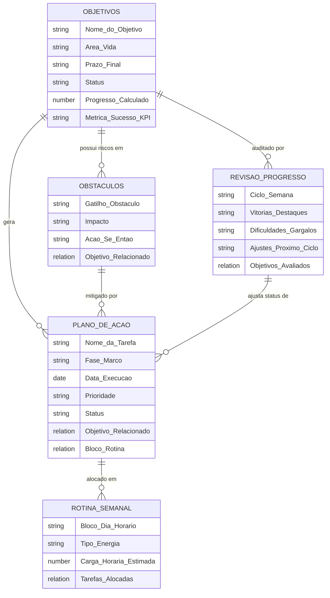
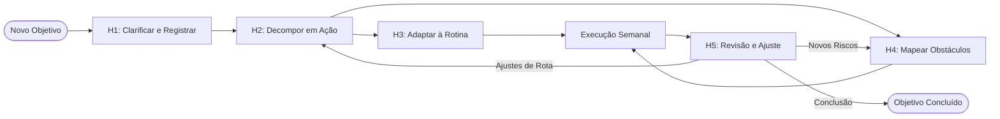

# 🚀 AI Planner Assistant: Sistema de Planejamento Inteligente no Notion & IA

> **Projeto Final:** Assistente de Planejamento com Notion e Habilidades Reutilizáveis de Inteligência Artificial.  
> **Autor(a):** Portfólio de Engenharia de Prompts e Produtividade  
> **Status:** Concluído & Pronto para Replicação  

---

## 📌 Sumário
- [1. Visão Geral e Problema Resolvido](#1-visão-geral-e-problema-resolvido)
  - [O Problema](#o-problema)
  - [O Diferencial da Solução](#o-diferencial-da-solução)
- [2. Ferramentas Utilizadas e Justificativas](#2-ferramentas-utilizadas-e-justificativas)
- [3. Arquitetura do Planner no Notion](#3-arquitetura-do-planner-no-notion)
  - [Diagrama Relacional das Bases de Dados](#diagrama-relacional-das-bases-de-dados)
  - [Dicionário de Dados e Propriedades](#dicionário-de-dados-e-propriedades)
- [4. Catálogo de Habilidades (AI Skills)](#4-catálogo-de-habilidades-ai-skills)
  - [Habilidade 1: Clarificação e Registro do Objetivo (SMART/OKR)](#habilidade-1-clarificação-e-registro-do-objetivo)
  - [Habilidade 2: Decomposição em Plano de Ação (WBS / Tarefas)](#habilidade-2-decomposição-em-plano-de-ação)
  - [Habilidade 3: Adaptação à Rotina e Alocação de Tempo](#habilidade-3-adaptação-à-rotina-e-alocação-de-tempo)
  - [Habilidade 4: Antecipação de Obstáculos e Estratégia Se-Então](#habilidade-4-antecipação-de-obstáculos-e-estratégia-se-então)
  - [Habilidade 5: Revisão Periódica e Acompanhamento Ágil](#habilidade-5-revisão-periódica-e-acompanhamento-ágil)
  - [Habilidade Bônus (H6): Resumo Executivo para Calendário / Timeblocking](#habilidade-bônus-h6-resumo-executivo-para-calendário--timeblocking)
- [5. Demonstração Prática: Estudo de Caso Completo](#5-demonstração-prática-estudo-de-caso-completo)
  - [Contexto do Objetivo Fictício](#contexto-do-objetivo-fictício)
  - [Execução da Habilidade 1 (Objetivo)](#execução-da-habilidade-1)
  - [Execução da Habilidade 2 (Plano de Ação)](#execução-da-habilidade-2)
  - [Execução da Habilidade 3 (Rotina)](#execução-da-habilidade-3)
  - [Execução da Habilidade 4 (Obstáculos)](#execução-da-habilidade-4)
  - [Execução da Habilidade 5 (Revisão)](#execução-da-habilidade-5)
  - [Mockup Visual e Telas de Exemplo](#mockup-visual-e-telas-de-exemplo)
- [6. Como Replicar no Notion e no ChatGPT](#6-como-replicar-no-notion-e-no-chatgpt)
- [7. Checklist de Validação para Entrega](#7-checklist-de-validação-para-entrega)

---

## 1. Visão Geral e Problema Resolvido

### O Problema
A maioria das pessoas falha ao tirar metas do papel não por falta de vontade, mas por:
1. **Objetivos vagos e descontextualizados:** Metas como *"aprender inglês"* ou *"mudar de carreira"* sem marcos claros nem métricas de sucesso mensuráveis.
2. **Inércia operacional:** Falta de clareza sobre qual é a próxima ação prática imediata (próximo passo de 30 minutos).
3. **Desconexão com a rotina real:** Cronogramas utópicos que ignoram a carga de trabalho diária, a energia disponível e as responsabilidades pré-existentes.
4. **Desistência diante do primeiro imprevisto:** Ausência de planos de contingência antecipados (protocolos *"Se-Então"*).
5. **Falta de ciclo de feedback:** Não há revisão semanal do que funcionou ou falhou, tornando o planejamento um documento estático e esquecido.

### O Diferencial da Solução
O **AI Planner Assistant** une **inteligência metodológica** (via prompts/habilidades estruturadas de IA) à **infraestrutura relacional do Notion**. Ele transforma um simples chat com IA em um **sistema vivo de governança pessoal e profissional**:

* **Universal:** O mesmo motor de habilidades funciona para metas de estudo, carreira, transição profissional ou lançamento de novos negócios.
* **Modular e Reutilizável:** Você não precisa reexplicar o método a cada interação; cada habilidade sabe seu gatilho, seu modelo mental e o formato exato de saída.
* **Integrado e Relacional:** As tarefas alimentam a rotina, que alimenta os obstáculos previstos, que são auditados na base de revisão contínua.

---

## 2. Ferramentas Utilizadas e Justificativas

| Ferramenta | Papel no Sistema | Justificativa da Escolha |
| :--- | :--- | :--- |
| **Notion** | Banco de dados, visualização e armazenamento do sistema | • Modelagem relacional nativa (permite vincular metas a ações, rotinas e revisões).<br>• Múltiplas visualizações (Kanban, Calendário, Timeline, Tabela).<br>• Suporte nativo a fórmulas e barras de progresso automatizadas.<br>• Plano gratuito completo para estruturação pessoal. |
| **ChatGPT / Notion AI** | Motor cognitivo e execução das habilidades | • Processamento de linguagem natural para transformar ideias abstratas em WBS (Work Breakdown Structure).<br>• Capacidade de seguir instruções rígidas através de *Custom Instructions* ou *Custom GPTs*.<br>• Redução drástica do atrito cognitivo no início de qualquer planejamento. |

---

## 3. Arquitetura do Planner no Notion

O sistema é sustentado por **5 bases de dados relacionais principais**:



### Dicionário de Dados e Propriedades

#### 1. Base: `🎯 Objetivos (Goals & OKRs)`
* **Objetivo (Title):** Nome claro e orientado a resultado.
* **Área (Select):** `Carreira` | `Estudos` | `Finanças` | `Saúde` | `Negócios`.
* **Prazo Final (Date):** Data limite estabelecida.
* **Status (Status):** `Não Iniciado` | `Em Andamento` | `Concluído` | `Pausado`.
* **Progresso (Rollup / Formula):** Percentual calculado a partir das tarefas concluídas em *Plano de Ação*.
* **Métrica de Sucesso / KPI (Text):** Indicador numérico ou condição clara de conclusão.

#### 2. Base: `📋 Plano de Ação (Tasks & Milestones)`
* **Tarefa / Ação (Title):** Ação imperativa direta (ex: *"Configurar bucket S3 no laboratório AWS"*).
* **Fase / Marco (Select):** `Fase 1: Fundamentos` | `Fase 2: Prática` | `Fase 3: Portfólio` | etc.
* **Objetivo Vinculado (Relation):** Relação Many-to-One com *🎯 Objetivos*.
* **Data / Prazo (Date):** Data agendada para execução.
* **Prioridade (Select):** `P1 - Crítico` | `P2 - Alto` | `P3 - Médio` | `P4 - Opcional`.
* **Status (Status):** `A Fazer` | `Em Progresso` | `Impedido` | `Concluído`.
* **Duração Estimada (Number):** Tempo em minutos (ex: `45`, `90`).

#### 3. Base: `⏰ Rotina & Alocação de Tempo (Timeboxing)`
* **Bloco Semanal (Title):** Ex: *"Segunda/Quarta - Bloco de Foco Noturno (20h - 22h)"*.
* **Dia da Semana (Multi-select):** `Segunda` | `Terça` | `Quarta` | `Quinta` | `Sexta` | `Sábado` | `Domingo`.
* **Nível de Energia Exigido (Select):** `Alta (Foco Profundo)` | `Média (Operacional)` | `Baixa (Revisão Leve)`.
* **Capacidade Semanal (Number):** Horas disponíveis por semana naquele bloco.
* **Ações Alocadas (Relation):** Tarefas atreladas vindas do *📋 Plano de Ação*.

#### 4. Base: `🛡️ Obstáculos & Planos de Contingência (If-Then)`
* **Risco / Obstáculo Previsto (Title):** O gatilho que pode atrapalhar o plano.
* **Probabilidade & Impacto (Select):** `Alta / Severo` | `Média / Moderado` | `Baixa / Leve`.
* **Estratégia Se-Então (Text):** *"SE [imprevisto acontecer], ENTÃO eu vou [ação de salvaguarda imediata]"*.
* **Objetivo Vinculado (Relation):** Relação com a base de *🎯 Objetivos*.

#### 5. Base: `🔍 Acompanhamento & Revisões (Weekly Reviews)`
* **Ciclo / Data (Title):** Ex: *"Semana 01 - 01/Dez a 07/Dez"*.
* **Data da Revisão (Date):** Registro do momento da checagem.
* **O que funcionou bem? (Text):** Vitórias e tarefas finalizadas.
* **Onde houve bloqueio? (Text):** Desvios de rota, procrastinação ou sobrecarga.
* **Decisão / Próximos Passos (Select):** `Manter Ritmo` | `Ajustar Prazos` | `Eliminar Escopo`.

---

## 4. Catálogo de Habilidades (AI Skills)

As 5 habilidades fundamentais (mais 1 habilidade bônus) foram projetadas para serem independentes de domínio, garantindo que o assistente processe qualquer meta.



---

### Habilidade 1: Clarificação e Registro do Objetivo
* **Nome Técnico:** `SKILL_01_GOAL_CLARIFICATION`
* **Gatilho:** Sempre que o usuário apresentar uma ideia, desejo ou meta bruta inicial.
* **Objetivo:** Filtrar a ambiguidade, aplicar a metodologia SMART/OKR e extrair as propriedades fundamentais para a base *🎯 Objetivos*.
* **Instrução / Prompt:**
```markdown
Você é o especialista de planejamento do sistema AI Planner. Sua missão nesta etapa é pegar qualquer objetivo bruto fornecido pelo usuário e transformá-lo em uma meta cristalina, acionável e sem ambiguidades.

DIRETRIZES DE AÇÃO:
1. Analise o objetivo recebido sob os critérios SMART (Específico, Mensurável, Atingível, Relevante, Temporal).
2. Se faltarem informações críticas (como prazo ou dedicação semanal), faça no máximo 2 perguntas diretas antes de assumir premissas razoáveis.
3. Formate a saída OBRIGATORIAMENTE no padrão de campos da base de dados do Notion:
   - Nome do Objetivo: [Frase de impacto orientada a resultado]
   - Área da Vida: [Carreira / Estudos / Negócios / Saúde / Finanças]
   - Prazo Final Sugerido: [Data específica ou horizonte em semanas/meses]
   - Indicador de Sucesso (KPI): [Como medimos objetivamente que foi concluído]
   - Declaração de Relevância (O "Porquê"): [Benefício direto em 1 frase]
```

---

### Habilidade 2: Decomposição em Plano de Ação
* **Nome Técnico:** `SKILL_02_ACTION_BREAKDOWN_WBS`
* **Gatilho:** Após a definição clara do objetivo validado pela H1.
* **Objetivo:** Decompor a meta em fases lógicas, marcos (milestones) e microtarefas com esforço estimado e prioridade.
* **Instrução / Prompt:**
```markdown
Você é o arquiteto de tarefas do AI Planner. Sua função é receber um objetivo validado e decompô-lo em uma estrutura de divisão do trabalho (WBS) prática, sem deixar etapas genéricas.

DIRETRIZES DE AÇÃO:
1. Divida o caminho em 3 ou 4 fases cronológicas bem definidas.
2. Cada fase deve conter de 3 a 5 tarefas objetivas.
3. Use sempre verbos no infinitivo para as tarefas (ex: "Construir", "Configurar", "Escrever").
4. Atribua para cada tarefa:
   - Duração estimada (máximo de 90 minutos por tarefa; divida tarefas maiores em partes).
   - Nível de Prioridade: P1 (Crítico), P2 (Importante), P3 (Complementar).
   - Marco de Validação (Entregável tangível).
5. Exiba a resposta em formato de tabela Markdown pronta para ser copiada para a base "Plano de Ação" do Notion.
```

---

### Habilidade 3: Adaptação à Rotina e Alocação de Tempo
* **Nome Técnico:** `SKILL_03_ROUTINE_TIMEBOXING`
* **Gatilho:** Quando as tarefas do plano de ação precisam ser encaixadas na agenda semanal real do usuário.
* **Objetivo:** Mapear a disponibilidade, gerenciar a energia e evitar a sobrecarga criando blocos de tempo (*Timeboxing*).
* **Instrução / Prompt:**
```markdown
Você é o estrategista de produtividade e rotina do AI Planner. Seu objetivo é cruzar a lista de tarefas prioritárias com a realidade da semana do usuário, respeitando limites biológicos e cognitivos.

DIRETRIZES DE AÇÃO:
1. Colete ou utilize a disponibilidade semanal do usuário (dias, turnos e horas líquidas).
2. Agrupe as tarefas de alta demanda cognitiva em blocos de "Foco Profundo" (Deep Work) e as tarefas menores em blocos de "Execução Rápida" (Shallow Work).
3. Nunca aloque mais de 80% do tempo livre disponível (reserva de 20% para fadiga e imprevistos).
4. Produza a grade da semana sugerindo os dias, blocos horários e quais tarefas do Plano de Ação devem ser executadas em cada bloco.
```

---

### Habilidade 4: Antecipação de Obstáculos e Estratégia Se-Então
* **Nome Técnico:** `SKILL_04_OBSTACLE_CONTINGENCY_WOOP`
* **Gatilho:** Antes do início da execução ou após a estruturação da rotina.
* **Objetivo:** Realizar um *Pre-Mortem* (antecipar falhas) e gerar planos de resposta imediata no formato *Se-Então* (Implementation Intentions).
* **Instrução / Prompt:**
```markdown
Você é o analista de mitigação de riscos do AI Planner. Seu papel é identificar os 3 a 5 maiores obstáculos comportamentais, ambientais e técnicos que ameaçam o plano antes que eles aconteçam.

DIRETRIZES DE AÇÃO:
1. Identifique riscos internos (ex: cansaço após o expediente, procrastinação em tópicos difíceis) e externos (ex: emergências familiares, horas extras no trabalho).
2. Para cada risco, construa um protocolo no formato comportamental rigoroso:
   "SE [Gatilho/Situação de Bloqueio], ENTÃO [Ação corretiva imediata e de baixo atrito]."
3. Preencha uma matriz de contingência pronta para a base "Obstáculos & Mitigações" do Notion, incluindo Grau de Probabilidade e Medida Preventiva.
```

---

### Habilidade 5: Revisão Periódica e Acompanhamento Ágil
* **Nome Técnico:** `SKILL_05_PROGRESS_REVIEW_RETRO`
* **Gatilho:** Ao final de cada ciclo semanal de execução ou quando o plano emperrar.
* **Objetivo:** Fazer a retrospectiva ágil, diagnosticar a causa-raiz de desvios e recalcular a rota sem culpa.
* **Instrução / Prompt:**
```markdown
Você é o facilitador de melhoria contínua do AI Planner. Seu papel é conduzir uma revisão objetiva, sem julgamento moral, focada em métricas e aprendizado prático.

DIRETRIZES DE AÇÃO:
1. Solicite o status das tarefas planejadas para o ciclo encerrado (concluídas vs. não concluídas).
2. Avalie a taxa de aderência ao plano (%) e identifique a causa-raiz das tarefas postergadas (falha na estimativa de tempo, cansaço, imprevisto externo).
3. Entregue um parecer de revisão estruturado com:
   - Vitórias da Semana (reforço positivo de progresso tangível).
   - Gargalos Identificados.
   - Ajustes de Rota para o Próximo Ciclo (eliminar tarefas desnecessárias, recalcular prazos ou remanejar blocos).
   - Registro para a base "Acompanhamento & Revisões" do Notion.
```

---

### Habilidade Bônus (H6): Resumo Executivo para Calendário / Timeblocking
* **Nome Técnico:** `SKILL_06_CALENDAR_DIGEST_EXPORT`
* **Gatilho:** Quando o usuário deseja sincronizar o plano semanal com o Google Agenda ou Outlook sem integrações pagas.
* **Objetivo:** Gerar eventos em lote estruturados com título, descrição, horário e duração para importação rápida ou inclusão direta no calendário.
* **Instrução / Prompt:**
```markdown
Você é o exportador de sincronização do AI Planner. Transforme a alocação da semana gerada na H3 em uma listagem limpa de eventos de calendário contendo:
- Título do Evento: [Tag] + Nome da Tarefa
- Dia sugerido e Janela de Horário
- Checklist de preparação do evento (o que deixar aberto na tela antes de começar)
```

---

## 5. Demonstração Prática: Estudo de Caso Completo

Para demonstrar o assistente funcionando de ponta a ponta sem expor nenhum dado pessoal, escolhemos um estudo de caso real e fictício:

> **Estudo de Caso Fictício:**  
> **Nome da Persona:** Lucas Miranda (30 anos, Analista de Suporte de TI).  
> **Objetivo Declarado Inicial:** *"Quero aprender Engenharia de Dados em nuvem com foco em AWS e criar um portfólio para conseguir minha primeira vaga de Júnior em 6 meses."*  
> **Disponibilidade:** 8 horas semanais (terças e quintas à noite, mais sábado pela manhã).

A seguir, a transcrição completa de como cada habilidade atuou para estruturar o projeto no Notion.

---

### Execução da Habilidade 1: Clarificação e Registro do Objetivo

**Prompt do Usuário:**
> *"Ativar Habilidade 1. Quero aprender Engenharia de Dados em nuvem com AWS e criar um projeto de portfólio para virar Engenheiro de Dados Júnior em 6 meses. Tenho 8h livres por semana."*

**Resposta Gerada pelo AI Planner Assistant:**

```markdown
🎯 [Habilidade 1 Concluída] - Objetivo Estruturado para o Notion:

• Nome do Objetivo: Transição de Carreira para Engenheiro de Dados Cloud (AWS) Júnior
• Área da Vida: Carreira / Estudos
• Prazo Final Sugerido: 25 de Maio de 2027 (Horizonte de 24 semanas / 6 meses)
• Dedicação Semanal Prevista: 8 horas/semana (Total de 192 horas líquidas)
• Indicador de Sucesso (KPI):
  1. Pipeline de dados completo rodando em AWS (S3 -> Glue/Spark -> Athena/Redshift) com código documentado no GitHub.
  2. Currículo e LinkedIn otimizados + mínimo de 3 projetos técnicos avaliáveis.
• Declaração de Relevância (O "Porquê"):
  Migrar de suporte técnico para uma área de alta demanda e especialização, viabilizando crescimento salarial e técnico.

Próximo Passo Recomendado: Executar a Habilidade 2 para decompor a meta em 4 fases e no Plano de Ação detalhado.
```

---

### Execução da Habilidade 2: Decomposição em Plano de Ação

**Prompt do Usuário:**
> *"Ativar Habilidade 2 para este objetivo da AWS."*

**Resposta Gerada pelo AI Planner Assistant (Pronta para a tabela do Notion):**

| ID | Tarefa / Ação | Fase | Prioridade | Duração Est. | Marco / Entregável | Status |
| :---: | :--- | :--- | :---: | :---: | :--- | :---: |
| **T01** | Mapear conceitos de Data Lake, ETL e SQL Analítico | Fase 1: Fundamentos | P1 | 90 min | Resumo conceitual no Notion | `A Fazer` |
| **T02** | Praticar consultas avançadas em SQL (Window Functions & Joins) | Fase 1: Fundamentos | P1 | 90 min | 15 exercícios no LeetCode/HackerRank | `A Fazer` |
| **T03** | Criar conta Free Tier na AWS e configurar permissões IAM seguras | Fase 1: Fundamentos | P1 | 60 min | Usuário IAM com MFA ativo | `A Fazer` |
| **T04** | Criar script Python para extração de dados de uma API pública | Fase 2: Ingestão | P1 | 90 min | Script rodando local com dados em JSON | `A Fazer` |
| **T05** | Configurar bucket S3 e pipeline de ingestão via AWS Boto3 | Fase 2: Ingestão | P2 | 90 min | Dados brutos gravados no S3 | `A Fazer` |
| **T06** | Configurar AWS Glue Crawler e Data Catalog para catalogação | Fase 3: Processamento | P2 | 75 min | Esquema de tabelas visível no Glue | `A Fazer` |
| **T07** | Escrever transformação de dados com PySpark no AWS Glue Job | Fase 3: Processamento | P1 | 90 min | Dados em formato Parquet no S3 refinado | `A Fazer` |
| **T08** | Realizar consultas analíticas no Amazon Athena | Fase 3: Processamento | P2 | 60 min | Queries de agregação salvas | `A Fazer` |
| **T09** | Conectar Power BI / Looker Studio ao Athena para Dashboard | Fase 4: Apresentação | P3 | 90 min | Painel analítico funcional | `A Fazer` |
| **T10** | Documentar repositório GitHub com arquitetura e manual de deploy | Fase 4: Apresentação | P1 | 90 min | README com diagrama arquitetural | `A Fazer` |

---

### Execução da Habilidade 3: Adaptação à Rotina e Alocação de Tempo

**Prompt do Usuário:**
> *"Ativar Habilidade 3. Minha rotina real: Terças (20h às 22h), Quintas (20h às 22h) e Sábados (08h às 12h). Quero alocar as primeiras tarefas."*

**Resposta Gerada pelo AI Planner Assistant:**

```markdown
⏰ [Habilidade 3 Concluída] - Grade Semanal de Foco (8h Alocadas com 15% de folga):

📌 Terça-feira (20h00 - 21h45) | Bloco: Deep Work Noturno 1 (1h45m)
• Tarefa Alocada: T01 - Mapear conceitos de Data Lake, ETL e SQL Analítico (90 min)
• + 15 min de intervalo e anotação dos pontos de dúvida.

📌 Quinta-feira (20h00 - 21h30) | Bloco: Deep Work Noturno 2 (1h30m)
• Tarefa Alocada: T03 - Criar conta Free Tier na AWS e configurar IAM/MFA (60 min)
• + 30 min de exploração do console da AWS.

📌 Sábado (08h30 - 11h45) | Bloco: Construtor de Fim de Semana (3h15m)
• Bloco 1 (08h30 - 10h00): T02 - Praticar consultas avançadas em SQL (90 min)
• Intervalo biológico: 15 min (café, descanso de tela)
• Bloco 2 (10h15 - 11h45): Início da T04 - Script de extração da API (90 min)

💡 Reserva de Segurança: Quarta-feira e Domingo ficam 100% livres de compromisso com a meta.
```

---

### Execução da Habilidade 4: Antecipação de Obstáculos e Estratégia Se-Então

**Prompt do Usuário:**
> *"Ativar Habilidade 4. Meus riscos clássicos são: chegar esgotado do trabalho na terça/quinta e travar quando o ambiente da AWS der erro estranho."*

**Resposta Gerada pelo AI Planner Assistant:**

```markdown
🛡️ [Habilidade 4 Concluída] - Matriz de Salvaguardas & Protocolos Se-Então:

1. Risco: Esgotamento mental pós-expediente (Terça ou Quinta-feira)
   • Impacto: Alto | Probabilidade: Alta
   • Protocolo Se-Então:
     "SE eu estiver exausto às 20h, ENTÃO não vou tentar programar do zero; vou apenas assistir a 1 aula gravada ou ler documentação por 25 minutos no modo passivo e remarcar o bloco prático para o sábado."

2. Risco: Bloqueio técnico / erro de configuração na AWS
   • Impacto: Moderado | Probabilidade: Alta
   • Protocolo Se-Então:
     "SE um erro técnico persistir por mais de 30 minutos sem progresso, ENTÃO eu paro o cronômetro, documento o log do erro no Notion com o print e submeto a dúvida no fórum/Stack Overflow, mudando imediatamente para a próxima tarefa de SQL."

3. Risco: Cobranças surpresa de fatura no cartão (custos acidentais da nuvem)
   • Impacto: Crítico | Probabilidade: Baixa
   • Protocolo Se-Então:
     "SE eu criar qualquer recurso na AWS, ENTÃO configurarei um alerta de billing (AWS Budgets) no valor de US$ 5,00 no primeiro dia de acesso."
```

---

### Execução da Habilidade 5: Revisão Periódica e Acompanhamento Ágil

**Prompt do Usuário (Fim da Semana 1):**
> *"Ativar Habilidade 5. Consegui fazer a T01 na terça e a T03 na quinta. No sábado, meu sobrinho ficou doente e só consegui fazer metade da T02 de SQL. A T04 nem comecei."*

**Resposta Gerada pelo AI Planner Assistant:**

```markdown
🔍 [Habilidade 5 Concluída] - Relatório da Semana 01

📊 Métricas do Ciclo:
• Horas Planejadas: 8h | Horas Realizadas: 5h30m (Aderência: 68.7%)
• Tarefas Entregues: 2 de 4 (T01 e T03 concluídas; T02 em 50%; T04 postergada)

🏆 Vitórias da Semana:
• Ambiente AWS provisionado com sucesso e boas práticas de segurança configuradas.
• Base teórica de Data Lake e ETL consolidada.

⚠️ Diagnóstico de Gargalo:
• O imprevisto de sábado foi familiar (externo e inevitável). Não há falha estrutural de método, apenas necessidade de repactuação da carga da T02 e T04.

🔄 Ajustes de Rota para a Semana 02:
1. Terça-feira: Finalizar os 50% restantes da T02 (SQL Avançado - 45 min) + Iniciar T04 (45 min).
2. Quinta-feira: Finalizar T04 (Script de API - 90 min).
3. Sábado: Executar T05 (Bucket S3 e Boto3 - 90 min) e T06 (Glue Crawler - 75 min).
4. Status atualizado na base de Acompanhamento: "Progresso Estável com Ajuste de Cronograma".
```

---

### Mockup Visual e Telas de Exemplo

#### Visão no Notion: Painel Principal do Assistente (Board & Timeline)

```
========================================================================================
 🎯 MEU PLANNER INTELIGENTE: ENGENHARIA DE DADOS AWS (2027)
========================================================================================
 [ BARRA DE PROGRESSO GERAL ]  ████████░░░░░░░░░░░░  28% Concluído
----------------------------------------------------------------------------------------

 📋 PLANO DE AÇÃO (Visão por Status / Kanban)
 +-------------------+  +-----------------------+  +-----------------------+
 |    A FAZER (5)    |  |    EM PROGRESSO (1)   |  |     CONCLUÍDO (2)     |
 +-------------------+  +-----------------------+  +-----------------------+
 | [P1] T04 - Script |  | [P1] T02 - SQL Avanç. |  | [P1] T01 - Conceitos  |
 | [P2] T05 - S3/Boto|  |       (50% feito)     |  | [P1] T03 - Conta AWS  |
 | [P2] T06 - Crawler|  +-----------------------+  +-----------------------+
 | [P1] T07 - PySpark|
 +-------------------+

 ⏰ GRADE DE ROTINA (Visão Semanal - Próximos Blocos)
 • Terça-feira  | 20h00 - 21h45 | 🧠 Foco Profundo | [T02] Finalizar SQL + [T04] Setup
 • Quinta-feira | 20h00 - 21h30 | 🧠 Foco Profundo | [T04] Script Python API
 • Sábado       | 08h30 - 11h45 | 🛠️ Construtor    | [T05] S3 Boto3 + [T06] Crawler

 🛡️ SALVAGUARDAS ATIVAS (Se-Então)
 • SE cansaço extremo pós-trabalho -> ENTÃO ler documentação passiva por 25m.
 • SE dúvida técnica > 30 minutos  -> ENTÃO registrar log e trocar de tarefa.
========================================================================================
```

---

## 6. Como Replicar no Notion e no ChatGPT

### Configuração no ChatGPT (Custom GPT ou Prompt de Sistema)
1. Crie um novo GPT ou cole as instruções gerais nas suas **Instruções Personalizadas** (Custom Instructions).
2. No campo de instruções do assistente, insira o arquivo de referência [`SKILLS_PROMPTS.md`](./SKILLS_PROMPTS.md).
3. Toda vez que quiser acionar uma etapa, basta digitar:  
   `Ativar Habilidade 1: [seu objetivo]`  
   `Ativar Habilidade 2`  
   `Ativar Habilidade 3: [sua rotina]`  
   `Ativar Habilidade 4: [seus riscos]`  
   `Ativar Habilidade 5: [o que aconteceu na semana]`

### Configuração no Notion
1. Crie uma página central chamada `AI Planner Assistant`.
2. Crie as 5 bases de dados conforme o [Dicionário de Dados](#dicionário-de-dados-e-propriedades).
3. Configure os relacionamentos (*Relation*) indicados no diagrama relacional.
4. Adicione na base de **Objetivos** a propriedade de **Rollup** apontando para a base **Plano de Ação** (calculando a porcentagem de caixas marcadas como *Concluído*).
5. Cole as saídas geradas pelo chat diretamente nas visualizações de tabela ou quadro Kanban.

---

## 7. Checklist de Validação para Entrega

Antes de submeter o repositório público, confira todos os itens:

- [x] **Universalidade:** As 5 habilidades operam com regras universais e funcionam para qualquer objetivo.
- [x] **Estrutura Relacional:** As 4 partes essenciais (plano de ação, rotina, obstáculos e acompanhamento) foram detalhadas com relações explícitas.
- [x] **Testabilidade:** Todas as habilidades foram acionadas e testadas com um estudo de caso real e fictício.
- [x] **Privacidade & Conformidade:** Zero dados pessoais ou confidenciais utilizados; todo o caso é fictício.
- [x] **Diagramas & Formatação:** Diagrama relacional em Mermaid e esquemas tabulares perfeitamente legíveis.
- [x] **Repositório:** Nome do repositório em minúsculas e sem caracteres especiais (`ai-planner-assistant`), pronto para visualização pública sem necessidade de login.
